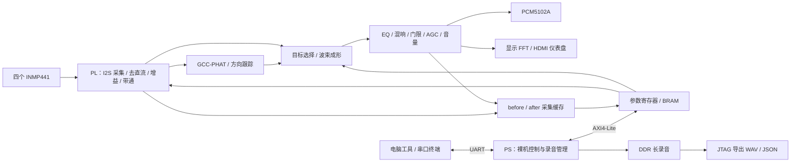

# AX7010 AUDIO PRO — 四麦定向拾音系统

基于 **AX7010 / Zynq-7010** 的四麦克风阵列音频系统，在 FPGA 中实现同步采集、声源方向估计、延迟叠加波束成形和语音滤波，配合 Cortex-A9 裸机程序完成串口控制、录音管理与离线 AI 推理，通过 HDMI 显示方向、电平和频谱。

**版本：v1.1.0** · **开发工具：Vivado / Vitis 2026.1** · **语言：Verilog / C / Python / PowerShell**

> 当前仓库包含已完成仿真与独立模块实现验证的 GCC-PHAT 源码。历史语音滤波固件已上板验证，但 GCC-PHAT 尚未生成、发布或下载新的配套 bit/XSA/ELF；RNNoise 目前用于 PS 离线处理，实时 DAC 通路仍由 PL 处理。

[硬件平台](#硬件平台) · [功能模块](#功能模块) · [系统架构](#系统架构) · [快速开始](#快速开始) · [开发状态](#开发状态) · [文档](#文档)

## 硬件平台

| 资源 | 型号 / 规格 |
| --- | --- |
| 开发板 / FPGA | AX7010 / `xc7z010clg400-1` |
| PS 处理器 | ARM Cortex-A9，裸机程序运行于 ARM0 |
| 音频与 AXI 时钟 | 50 MHz |
| 麦克风阵列 | 4 × INMP441，边长 50 mm 的正方形阵列 |
| 音频采样 | 四路同步 I2S，24 bit，实际采样率 48828.125 Hz |
| 音频输出 | PCM5102A I2S DAC |
| 显示输出 | HDMI，1280 × 720；实际刷新率略低于 60 Hz |
| 采集缓存 | 128 KiB BRAM；384 MiB DDR 长录音区 |
| 控制与导出 | UART 115200 / 8N1 / 无流控；JTAG 下载与 DDR 导出 |

### 麦克风与 DAC 接线

```text
        FRONT 0°
     mic3 ---- mic2
      | 50 mm  |
     mic0 ---- mic1  RIGHT 90°
```

四麦共用 SCK / WS，四路 SD 独立，所有 L/R 接地。

| 信号 | AX7010 J11 接口 |
| --- | --- |
| 麦克风 VDD | Pin39 / Pin40，3.3V |
| 公共 GND / 麦克风 L/R | Pin1 / Pin37 / Pin38 |
| 共用 SCK / PCM5102A BCK | Pin5 |
| 共用 WS / PCM5102A LRCK | Pin6 |
| mic0 SD | Pin3，FPGA F17 |
| mic1 SD | Pin4，FPGA F16 |
| mic2 SD | Pin8，FPGA G19 |
| mic3 SD | Pin9，FPGA H18 |
| PCM5102A DATA | Pin7 |

PCM5102A 共地，供电沿用已验证接法；板级引脚及时序约束见 [ax7010_audio.xdc](constr/ax7010_audio.xdc)。

## 功能模块

| 模块 | 源码 / 仿真 | 上板状态 | 说明 |
| --- | --- | --- | --- |
| 四麦采集与增益校准 | ✅ 已实现 | ✅ 历史固件已验证 | 四路同步采样、独立 Q6 增益、相对幅度校准与削顶提示 |
| GCC-PHAT 方向估计 | ✅ 回归与独立模块实现通过 | ⏳ 新固件待构建和下载 | 512 点 FFT/IFFT、四对麦克风、±8 点搜索、Q4 峰值插值 |
| 方向跟踪与波束成形 | ✅ 已实现 | ✅ 历史链路已验证 | 三点中值 / IIR、自动跟随、手动角度、锁定目标、分数延迟叠加 |
| 语音滤波与输出调理 | ✅ 已实现 | ✅ 历史固件已验证 | 语音 / 抗风 / 窄带档，EQ、混响、噪声门、AGC、音量与静音 |
| HDMI 仪表盘 | ✅ 已实现 | ✅ 历史固件已验证 | 四路电平、方向、目标角度、模式、录音状态与 16 柱频谱 |
| 短录音与 DDR 长录音 | ✅ 已实现 | ✅ 部分时长已验证 | before/after 双通道 WAV，最长容量约 34 分 21.6 秒，完整最大时长待实测 |
| PS 离线 RNNoise | ✅ 评估工具已实现 | ✅ 历史性能测试已完成 | Cortex-A9 推理、JTAG 输入输出、CRC 校验；本机编译器待补齐 |
| PS 实时 AI 音频回传 | ⏳ 待实现 | — | 需建立 PL→PS→PL 返回通路与实时调度 |

表中“历史固件已验证”来自既有项目记录，不表示本机刚完成构建或最新 GCC-PHAT 全链路已上板。

## 系统架构



Vivado 顶层为 `audio_ps_wrapper`，PL 功能顶层为 `audio_top`。长录音由 PS 经 AXI-Lite 读取 PL 环形缓存并写入 DDR，当前没有音频 AXI DMA 搬运通路。`before` 取自去直流后的 mic0，`after` 取自输出调理后的信号，均位于 DAC 输出选择之前；详细抽头位置见 [项目逻辑图](PROJECT_LOGIC.md)。

离线 AI 使用独立流程：电脑 WAV → 重采样至 48 kHz → JTAG 写入 DDR → PS RNNoise → JTAG 导出对照 WAV。它尚未接入上图的实时 DAC 链路。

## 通信与控制

| 通道 | 方向 | 配置 | 用途 |
| --- | --- | --- | --- |
| UART | 电脑 ↔ PS | 115200 bps，8N1，无流控 | 参数设置、状态读取、录音控制与短录音导出 |
| AXI4-Lite | PS ↔ PL | `audio_control` 基址 `0x43C00000` | 增益、音效、方向状态与采集缓存访问 |
| JTAG | 电脑 ↔ 板卡 | XSDB | bit/ELF 下载、DDR 长录音导出与离线 AI 评估 |

串口文本命令均需按回车，默认关闭周期日志。常用命令：

| 命令 | 操作 |
| --- | --- |
| `h` / `s` | 帮助 / 输出一次状态 |
| `a` / `l` / `angle 45` | 自动跟随 / 锁定目标 / 手动角度 |
| `band voice` / `band wind` / `band narrow` / `band off` | 选择带通档位 |
| `gain 0 64` / `cal` / `resetcal` | 单路增益 / 相对幅度校准 / 恢复单位增益 |
| `vol 96` / `gate 32` | 设置音量 / 噪声门阈值 |
| `n` / `g` / `u` | 切换噪声门 / AGC / 静音 |
| `log on` / `log off` | 开启 / 关闭周期状态日志 |
| `rec 10` / `rec max` / `stop` / `recinfo` | 长录音 / 录满 / 提前停止 / 录音状态 |

完整命令、默认参数、频带说明和寄存器偏移见 [使用指南](docs/user_guide.md)。

## 目录结构

```text
ax7010-audio-pro-main/
├── rtl/                      # 实时音频、DOA、波束、AXI 控制与 HDMI
├── sim/                      # 模块和链路 testbench
├── constr/                   # 引脚与时序约束
├── sw/
│   ├── doa_uart/             # PS 裸机控制与录音程序
│   └── ai_eval/              # PS RNNoise 离线推理程序
├── scripts/                  # 构建、仿真、下载、录音与分析工具
├── third_party/rnnoise/      # RNNoise v0.1.1 源码与原许可证
├── docs/
│   ├── doa_gcc_phat.md       # 算法、定点设计、验证和资源报告
│   └── user_guide.md         # 串口、录音、AI 评估与故障排查
├── PROJECT_LOGIC.md          # 系统数据流与源码索引
├── CONTRIBUTING.md           # 贡献和验证流程
├── AGENTS.md                 # 工程修改约定
├── LICENSE                  # MIT 许可证
└── README.md
```

`build/` 和 `captures/` 为本地生成目录，默认不纳入 Git；克隆仓库后需要自行构建产物和生成录音。

## 快速开始

### 1. 准备环境

安装 Vivado / Vitis 2026.1，并准备 Python 与 NumPy。脚本已按当前电脑配置：

| 项目 | 本机路径 |
| --- | --- |
| 项目根目录 | `C:/ax7010-audio-pro-main` |
| AMD 工具目录 | `C:/AMDDesignTools26.1/2026.1` |
| XSDB | `C:/AMDDesignTools26.1/2026.1/Vivado/bin/xsdb.bat` |
| Python | `C:/Users/t'x/.cache/codex-runtimes/codex-primary-runtime/dependencies/python/python.exe` |
| Vitis 工作区 | `build/vitis/workspaces/<时间戳>` |
| 最新工作区记录 | `build/vitis/last_workspace.txt` |

换电脑时检查批处理的安装路径及 Python 默认路径；PowerShell 音频工具支持 `-Python` 覆盖。Vitis 工作区使用无空格路径。**当前 AMD 安装目录未找到 `arm-none-eabi-gcc.exe`，AI 评估编译需补齐 Cortex-A9 工具链，或通过 `AX7010_ARM_GCC` 指定已有编译器。**

### 2. 构建 FPGA 与 PS 程序

在项目根目录的 PowerShell 中逐步执行，每步成功后再继续：

```powershell
cd C:\ax7010-audio-pro-main
.\scripts\run_sim.bat
.\scripts\test_speech_band.bat
.\scripts\create_project.bat
.\scripts\build_bitstream.bat
.\scripts\create_vitis.bat
```

也可运行 `.\scripts\build_all.bat` 完成上述流程。不要同时运行多个构建脚本。成功标记为 `FOURMIC_BUILD_PASS`、`DOA_UART_APP_PASS` 和总流程的 `BUILD_ALL_PASS`；失败后先处理错误，不能继续使用旧产物冒充新构建。

| 产物 | 路径 |
| --- | --- |
| Vivado 工程 | `build/project/ax7010_pro.xpr` |
| FPGA bitstream | `build/project/ax7010_pro.runs/impl_1/audio_ps_wrapper.bit` |
| 含 bit 的硬件平台 | `build/audio_fourmic.xsa` |
| 时序报告 / 硬件放行标记 | `build/timing.rpt` / `build/hardware_ready.txt` |
| PS ELF | 最新工作区下的 `doa_uart/build/doa_uart.elf` |
| 构建与下载日志 | `build/build_bitstream.log`、`build/vitis_build.log`、`build/download.log` |

### 3. 下载与启动

板卡上电，连接 JTAG 和串口，打开实际 COM 口并设置 115200 / 8N1 / 无流控，然后运行：

```powershell
.\scripts\run_doa_uart.bat
```

检查 `DOWNLOAD_PASS` 和串口中的 `AX7010 AUDIO PRO BOOT`。已有匹配产物时可直接下载；断电后需重新下载。COM6 是历史端口示例，请按本机设备替换。

### 4. 录音与试听

先设置方向和音效，再关闭串口终端，避免多个程序占用同一个 COM 口。保持板卡供电与 JTAG 连接，在项目根目录执行：

```powershell
powershell -ExecutionPolicy Bypass -File .\scripts\capture_long_audio.ps1 -Port COM6 -Seconds 10 -Output .\captures\compare10.wav
powershell -ExecutionPolicy Bypass -File .\scripts\listen_capture.ps1 -InputFile .\captures\compare10.wav
```

输出路径需使用新文件名。WAV 的 before/after 通道存在处理延迟和增益差异，不能把音量变化直接当作 SNR 提升。短录音、最大时长、单独导出和 AI 处理步骤见 [使用指南](docs/user_guide.md)。

## 开发状态

以下为已有记录，README 整理和路径修正没有重新执行这些硬件验证。

| 时间 / 范围 | 已完成 | 尚待验证 |
| --- | --- | --- |
| 历史语音滤波固件 | 仿真、实现、上板控制、10 秒录音与提前停止；HDMI 显示修正 | 完整最大录音时长、真实环境声学指标 |
| 2026-10-04 PS AI 评估 | 30 秒语音加收尾共 3001 帧；推理 8.144 秒；每 10 ms 帧平均 2.714 ms，最大 4.991 ms，无超期帧 | 重采样 / JTAG / 实时回传与并发任务的总开销 |
| 2026-10-07 GCC-PHAT | 十三项主回归、28 组算法测试、预处理链路与超时保护；独立模块 50 MHz 布局布线 | 集成全工程 bit/XSA/ELF 发布、下载、真实房间精度 |
| 2026-10-11 本机路径修正 | 工具路径、Python、统一 Vitis 工作区和脚本语法检查 | 本机完整构建与上板验证；ARM 编译器安装 |

GCC-PHAT 独立模块综合使用 LUT 1707、FF 710、BRAM36 5、DSP 13，布线 WNS 为 +7.234 ns；这些是独立模块结果，不能替代全工程时序签核。非静音计算约 2.38 ms，帧采集加计算约 12.86 ms，未包含方向平滑、PS 调度和 HDMI 刷新响应。完整结果见 [GCC-PHAT 报告](docs/doa_gcc_phat.md)。

下一步主要工作是生成并验证新 GCC-PHAT 配套固件、测量真实环境方向误差与跟踪延迟，以及建立 PS 实时 AI 音频返回通路。

## 文档

| 文档 | 内容 |
| --- | --- |
| [项目逻辑图](PROJECT_LOGIC.md) | 数据通路、控制逻辑、时钟、录音和源码索引 |
| [GCC-PHAT 技术报告](docs/doa_gcc_phat.md) | 算法设计、定点格式、测试结果、资源和时序范围 |
| [使用指南](docs/user_guide.md) | 完整串口命令、频段、录音导出、AI 评估和故障排查 |
| [贡献指南](CONTRIBUTING.md) | 开发环境、问题报告、提交和构建验证流程 |
| [工程约定](AGENTS.md) | 接口变化后的完整构建和配套产物要求 |

历史记录提到的 `build/verification.md`、`build/manifest.json` 和音频样本属于本地生成资料，当前仓库未附带，不作为已提供的发布产物。

## 技术亮点

- **四麦同步处理：**共用 I2S 时钟，独立 SD 输入，增益和带通在方向估计与波束成形之前执行。
- **独立方向运算核：**GCC-PHAT FFT/IFFT 真正参与延迟估计，与用于 HDMI 频谱显示的 FFT 分开运行；显式 `GCC_PHAT=0` 可回归旧时域实现。
- **定向拾音与可控音效：**自动跟踪、手动角度和目标锁定结合 Q4 分数延迟叠加，音效和输出调理通过串口配置。
- **连续对照录音：**BRAM 环形缓存配合 PS 搬运至 DDR，保留 before/after 双通道，导出时校验 CRC；溢出会报错并拒绝不完整录音。
- **可复现的 PS AI 评估：**固定 RNNoise v0.1.1 提交 `6cbfd53eb348a8d394e0757b4025c6ded34eb2b6`，记录帧耗时、输入输出 CRC 与对照 WAV。

## 贡献与许可证

欢迎提交问题报告、文档改进和代码贡献，流程见 [CONTRIBUTING.md](CONTRIBUTING.md)。修改 AXI 地址、寄存器、DMA、BRAM 接口、中断、时钟、PS-PL 接口或 Block Design 后，必须按 [AGENTS.md](AGENTS.md) 完成硬件、平台/BSP 和 ELF 的配套重建，并准确记录上板状态。

项目原创内容采用 [MIT License](LICENSE)。第三方依赖保留各自版权与许可证，RNNoise 许可见 [COPYING](third_party/rnnoise/COPYING)。
