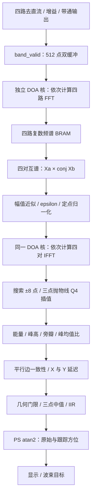

# GCC-PHAT 声源方向估计：实现与验证

[返回项目首页](../README.md) · [系统逻辑图](../PROJECT_LOGIC.md)

**验证记录日期：2026-10-07**。本文介绍 AX7010 AUDIO PRO 四麦方向估计的算法、RTL 实现和测试结果；本次整理只修改文档，没有重新运行测试或生成固件。

## 先看结论

默认 RTL 已用 GCC-PHAT 替代普通时域互相关。方向输出来自 PHAT 频谱的 IFFT 峰值，真正参与 `lag_x`、`lag_y` 计算；HDMI 频谱显示仍使用独立 FFT。

| 项目 | 已有验证结果 |
| --- | --- |
| 算法与回归 | 28 组算法测试、四档预处理链路、连续采样与超时保护通过；十三项主回归通过 |
| 实时计算预算 | 非静音计算约 2.38 ms，小于 512 点帧的 10.486 ms 采集时间 |
| 独立模块实现 | 50 MHz 布局布线完成，WNS +7.234 ns |
| 固件发布与上板 | 尚未生成、发布或下载这次 GCC-PHAT 配套 bit/XSA/ELF；历史上板固件仍为旧算法 |
| 声学效果 | 尚未完成真实房间方向误差、弱语音和多声源鲁棒性测量 |

> **读数边界：**Q4 表示 1/16 个采样点的输出格点，不代表实际方向精度；独立模块时序通过也不等于全工程时序通过。

阅读导航：[参数与术语](#1-参数与术语) · [算法流程](#2-算法如何得到方向) · [实现要点](#3-rtl-实现要点) · [定点设计](#4-定点格式与数值安全) · [验证结果](#5-验证结果) · [资源时序](#6-资源与时序) · [复现](#7-如何复现)

## 1. 参数与术语

### 1.1 这套阵列的计算范围

| 参数 | 数值 / 含义 |
| --- | --- |
| 阵列 | 四个麦克风，边长 50 mm 的正方形 |
| 采样率 `Fs` | 48828.125 Hz，即 50 MHz / 16 / 64 |
| 帧长度 `FRAME` | 每通道 512 点，双缓冲采集 |
| 麦克风对 | `(0,1)`、`(3,2)`、`(0,3)`、`(1,2)`，使用相邻边 |
| 搜索范围 `MAX_LAG` | ±8 个采样点，共 17 个候选延迟 |
| 输出延迟 | X/Y 各 signed9，Q4 格式 |
| 输入位置 | 去直流 → 增益 → 带通之后，取 24 bit 输出的 `[23:8]` |

按声速 343 m/s 和边长 0.05 m 计算：

```text
最大到达时间差 = 0.05 / 343 = 145.7726 μs
最大采样点差   = 0.05 × 48828.125 / 343 = 7.1178025 点
±8 搜索余量    = 0.8821975 点 ≈ 18.0674 μs
```

因此保留 ±8 搜索范围。这里使用 50 mm 相邻边，不使用 70.71 mm 对角线；改变实际安装尺寸后，需要重新评估搜索范围和方向几何门限。

### 1.2 容易混淆的术语

| 术语 | 在本项目中的含义 |
| --- | --- |
| DOA | 声源到达方向，这里估计水平面 0–359° 方位 |
| GCC-PHAT | 对互功率谱做幅值归一化，再由 IFFT 相关峰估计两路时间差 |
| TDOA / lag | 两个麦克风之间的到达时间差；RTL 以采样点表示 |
| Q4 | 延迟有 4 位小数，例如 `112 Q4 = 7 sample` |
| `valid` | 本帧通过 GCC-PHAT 的能量与相关峰检查 |
| `accepted` | 算法有效，并且通过方向跟踪器的几何门限；PS 公布这一标志 |
| `update` | 有一个新结果事件，拒绝帧也会产生事件 |
| OOC | 独立模块综合与实现，不包含全工程布局和时钟竞争 |

## 2. 算法如何得到方向

### 2.1 从普通互相关到 GCC-PHAT

旧实现直接累加 `a[n] × b[n+lag]`，比较不同延迟的相关峰。新实现先将四路音频转换到频域，对每对麦克风计算 `Xa × conj(Xb)`，再压低互谱幅值对峰形的影响。IFFT 的相关峰提供延迟，后续仍沿用原有方向坐标与跟踪逻辑。

这里的 PHAT 使用定点幅值近似与 epsilon 正则项，并非浮点欧氏范数实现。它依然需要能量、峰值和几何检查，不能保证任意噪声环境都给出可靠方向。

### 2.2 数据通路



默认调用关系：`audio_top → doa_square(GCC_PHAT=1) → doa_gcc_phat → doa_fft512`。同一个 DOA 运算核顺序完成四次 FFT 和四次 IFFT，不为每个麦克风单独实例化 FFT。

### 2.3 PHAT 和峰值搜索

```text
G = Xa × conj(Xb)
近似幅值 M = max(|Re(G)|, |Im(G)|) + 0.5 × min(|Re(G)|, |Im(G)|)
归一化输出 = Re(G)/(M+64) + j × Im(G)/(M+64)
```

归一化结果为 signed16 Q14。DC、Nyquist 和幅值不足 epsilon 的频点置零；两个分量使用并行的串行恢复除法，每频点 14 个周期。

IFFT 后搜索实部峰值。候选延迟 `lag` 读取 `IFFT[(-lag) mod 512]`，保持旧接口的延迟符号；正负延迟测试已核对这一映射。峰附近用三点抛物线插值：

```text
delta = 0.5 × (left - right) / (left - 2×center + right)
```

偏移四舍五入到 Q4，并钳制在 ±0.5 sample；分母为 0 时偏移为 0。

### 2.4 延迟如何变成角度

PS 沿用 `atan2(-x, -y)`，映射到 0–359°：前方 0°、右方 90°、后方 180°、左方 270°。例如 b 相比 a 滞后 7 点，对应 `+112 Q4`；`x>0, y=0` 对应左方 270°。

这是四麦平面方位估计，不使用双麦 `asin` 公式。X/Y 共用的 Q4 和采样率缩放在角度比值中抵消。零长度或不合理长度由跟踪器拒绝，平面阵列无法区分相同水平投影的上下方声源。

IIR 平滑 X/Y 延迟向量，避免直接平滑角度时跨越 359°/0° 的环绕问题。

## 3. RTL 实现要点

### 3.1 双缓冲与超时保护

| 信号 / 状态 | 含义 |
| --- | --- |
| `band_valid` / `en` | 四路滤波结果提交 / DOA 样本采集使能 |
| `wr == 511` | 一帧完成事件 |
| `bank` | 当前采集缓冲 |
| `readbank` | 当前锁定的计算缓冲 |
| `state == 0` | 可以接收一帧并启动计算 |

没有独立 `frame_done` 或 `buffer_sel` 端口。正常帧完成时，`readbank ← bank`、`bank ← ~bank`，随后启动计算。

旧实现忙时也翻转 bank，导致下一帧可能写入正在计算的缓冲。新 GCC 链路和保留的时域链路均改为：**忙时丢弃新帧、保持 bank，不覆盖锁定的计算数据。**超时仍会置 `overrun`，但当前帧结果不会因缓存被覆盖而污染。

DOA 采样使能改用 `speech_band.band_valid`，明确消费四路已经提交的滤波结果。

### 3.2 什么情况下接受一个结果

检查按麦克风对进行，再检查两条平行边：

| 检查项 | 通过条件 |
| --- | --- |
| 两路能量 | 每对的两通道帧能量都 ≥ `ENERGY_MIN`，默认 2097152 |
| 峰高度 | 实峰 ≥ 2048 Q14，即 0.125 |
| 峰位置 | 不在 ±8 搜索外缘 |
| 非邻近旁瓣 | 任意非邻近正峰 ≤ 主峰的 75% |
| 峰 / 平均绝对幅值 | 主峰与整个搜索窗口平均绝对幅值之比 ≥ 3 |
| 平行边一致性 | 两条平行边 Q4 延迟差 ≤ 16，即 1 sample |
| 跟踪器几何检查 | 延迟矢量长度满足原阵列门限 |

`quality` 保留 5 位接口，通过为 31，拒绝为 0。它不是连续置信概率，也不是语音 VAD 概率。

拒绝帧仍令 `update=1`、`frame_seq` 增长，但 `valid=0`，原始和跟踪方向保持上次值。`direction_track` 只在 `accepted` 时更新三点中值和 IIR；默认 `shift=2`，相当于 `0.75 × old + 0.25 × new`。

### 3.3 为什么不共享显示 FFT

`audio_spectrum` 绑定自己的采集、选频点和显示发布流程，没有外部变换请求、复数输入、频谱读出或 inverse 接口。共享它需要新增缓存、仲裁和返回标识，增加控制与验证成本。

因此新增独立 DOA 核。DOA 与显示各自拥有输入、RAM 和状态机，共用原有 50 MHz 时钟及音频来源。没有新增 Vivado `xfft` IP：FFT IP 数仍为 0，自写运算引擎由 1 个变为 2 个。XPM 用作存储宏，显示 FFT 仍不参与实时音频降噪。

原 `dc_block` 使用 `y=x-x1+y1-(y1>>>6)`，截止约 120 Hz；已有带通仍保留，未重复增加高通。PHAT 另外屏蔽 DC。频带操作见 [使用指南](user_guide.md)。

### 3.4 修改文件索引

| 文件 / 模块 | 修改 |
| --- | --- |
| [rtl/doa_square.v](../rtl/doa_square.v) | 保留原端口，默认 GCC_PHAT=1；新增 PHAT_EPSILON=64、PEAK_MIN=2048；GCC 固定 FRAME=512、MAX_LAG 1..8，拒绝误配；GCC_PHAT=0 可明确使用 legacy |
| [rtl/doa_time_domain.v](../rtl/doa_time_domain.v) | 保留原互相关实现并重命名；忙时不翻转 bank，供 64 点历史测试与回退使用 |
| [rtl/doa_gcc_phat.v](../rtl/doa_gcc_phat.v) | 新四通道帧缓存/频谱缓存、四对交叉功率谱与定点 PHAT、IFFT、搜索、Q4 与有效性发布 |
| [rtl/doa_fft512.v](../rtl/doa_fft512.v) | 新独立 FFT/IFFT 引擎，沿用显示 FFT 已验证蝶形算术和系数；独立工作 RAM、状态机；正逆变换配置运行时切换 |
| [rtl/audio_top.v](../rtl/audio_top.v) | DOA 样本使能 en 改为 band_valid；波束、DAC、频谱及 PS 接口保留 |
| [sim/tb_doa_gcc_phat.v](../sim/tb_doa_gcc_phat.v) | 新 28 组算法/边界/噪声测试、锁定 RAM 超时测试、CSV 和延迟统计，连接真实方向跟踪器 |
| [sim/tb_doa_gcc_band.v](../sim/tb_doa_gcc_band.v) | 新实际 dc_block+speech_band 四档、每档四帧，稳定态误差与启动过渡验证 |
| [sim/tb_doa_square.v](../sim/tb_doa_square.v) | 64 点历史互相关测试明确 GCC_PHAT=0；tb_doa_full 默认测试新链路连续 512 点采样 |
| [scripts/test.tcl](../scripts/test.tcl)、[scripts/run_sim.bat](../scripts/run_sim.bat) | 新模块/用例纳入主回归及工具目录修正 |
| [scripts/test_doa_gcc.tcl](../scripts/test_doa_gcc.tcl) | 独立六项回归，日志写入 build/doa_gcc |
| [scripts/check_doa_resources.tcl](../scripts/check_doa_resources.tcl) | 独立 DOA 原始快照/新版本综合及布局布线复现，产物隔离 |
| [README.md](../README.md)、[docs/doa_gcc_phat.md](../docs/doa_gcc_phat.md) | 更新项目说明与算法验证报告 |

文件链接指向项目中的对应源码。其中 `run_sim.bat` 当前使用本机 `C:/AMDDesignTools26.1/2026.1` 安装目录；独立测试 Tcl 通过 `XILINX_VIVADO` 定位 XPM 模型。

初次综合时，频谱缓存虽标注 block 仍退化为 LUTRAM；改为显式 XPM 双端口 RAM 后，最终使用 5 个 BRAM36。

## 4. 定点格式与数值安全

### 4.1 各阶段的位宽与缩放

| 节点 | signed 位宽 | 小数位/缩放 |
|---|---:|---|
| INMP441 ADC/I2S、HPF/增益/带通输出 | 24 | PCM 整数，F=0；带通内部另有 4 位小数 |
| DOA/FFT 输入 | 16 | F=0，取 24-bit PCM[23:8]，舍去 8 LSB |
| FFT twiddle | 16 | Q1.15；正逆变换改变正弦符号 |
| FFT 输出 Re/Im | 各16 | F=0，每级 /2，9 级合计 FFT/512；每级 signed 饱和 |
| 复乘的单个乘积 | 32 | F=0 |
| 互谱 Re/Im | 各33 | F=0，FFT 缩放后的频谱计数平方；两项加减先显式符号扩展 |
| PHAT abs | unsigned33 | 含 signed 极小数的绝对值 |
| PHAT 分母/余数 | unsigned35 | max+min/2+epsilon；试减使用 36 位左移结果 |
| PHAT 输出 | Re/Im 各16 | Q2.14，归一化绝对值<1；商 14 位小数，无浮点 |
| IFFT 输出/相关峰 | Re/Im 各16 | Q2.14，9 级 /2 得 IFFT/512；搜索使用 signed 实部 |
| Q4 delay | 9 | F=4，两个平行边求和/差先扩展 signed10 |
| 插值中间量 | signed/unsigned21 | 峰相邻差×8 和曲率先扩展，最多 8 次减法，分母0时 delta=0 |
| tracker 内部 | signed16 累加、signed17 更新 | 在输入 Q4 之上再保留 6 位小数 |
| 角度 | PS double 运算→int | atan2 的浮点仅用于原 PS 角度显示，不在 PL PHAT；整数度 0..359 |


PHAT 的 PL 运算没有浮点；表中的 PS `double` 只用于原有角度计算。

### 4.2 幅值近似的取舍

`max + 0.5×min` 不低估欧氏范数，最大相对高估为 `sqrt(1.25)-1 ≈ 11.8034%`，因此不会异常放大归一化分量。epsilon=64 的单位是 FFT 计数平方，不是声压或固定 SNR。

极小频点直接抑制，避免 PHAT 放大量化噪声。实现只使用移位、比较和减法，没有 sqrt、浮点除法器、倒数 LUT 或 Newton-Raphson。逐频点处理仍满足帧预算，因此没有采用大组合除法器。

### 4.3 溢出与量化检查

| 节点 | 上界 / 保护 |
| --- | --- |
| 16 bit 输入平方与帧能量 | 单样本 ≤ 2^30；512 点能量 ≤ 2^39，48 位累加安全 |
| 互谱与除法 | 互谱 33 位、分母 35 位、试减 36 位保留余量 |
| 搜索窗口幅值累计 | 17 个 signed16 峰绝对值之和 ≤ 557056，21 位安全 |
| 旁瓣与插值 | 旁瓣比较先扩展到 19 位再乘 4/3；插值差值与曲率先扩展 |
| FFT | 每级算术右移和 signed 饱和，9 级合计缩放 /512 |

逐级右移会带来弱信号量化误差。能量、epsilon 和峰检查用于拒绝不可靠结果，不能将 Q4 格点视为物理精度保证。当前采用 512 点循环 GCC，没有窗函数、频谱插值或额外零填充；有限帧边界和反射仍会影响估计。

## 5. 验证结果

### 5.1 验证覆盖

历史测试使用 Vivado 2026.1 官方 XPM 模型，经 `xvlog / xelab / xsim` 完成。十三项主回归全部通过，标记为 `FOURMIC_TEST_PASS`。

| 范围 | 结果 |
| --- | --- |
| 整数延迟 0 / ±1 / ±3 / ±7 点 | 相关峰与 Q4 延迟正确；有效方位还受几何门限限制 |
| 半采样、幅度不等、噪声与弱反射 | 指定测试案例通过 |
| 静音、低能量、纯直流、通道静音 | 拒绝结果并保持旧方向 |
| 11 帧独立噪声片段 | 全部拒绝，不代表所有噪声环境零误报 |
| 四档预处理联合链路 | 每档四帧，稳定态最多 1/16 点误差 |
| 正常采样与故意超时 | 正常连续帧通过；超时不覆盖计算 bank |
| 其他回归 | 旧互相关、显示 FFT、tracker、I2S、波束、音效、TMDS、AXI、输出调理与录音缓存通过 |

默认 GCC-PHAT 的 delay 唯一来源是 PHAT 谱 IFFT 的峰；只有显式 `GCC_PHAT=0` 才选择旧时域实现。

### 5.2 如何读测试表

- 延迟单位为 sample；方括号内为 RTL Q4 值。
- `valid/accepted` 分别表示算法检查和最终几何检查的结果。
- 原始 / 跟踪角度由 RTL 延迟按现有 PS 公式换算。
- invalid 行显示上次保留的方向，不计算静音或独立噪声的“方向误差”。
- `(1,0)`、`(3,0)` 等测试向量不满足阵列远场长度门限，所以可以 `valid=1` 而 `accepted=0`；全同步 `(0,0)` 的方位未定义。

<details>
<summary>展开完整 28 组测试结果</summary>

| Case/场景 | Expected (X,Y) sample | Estimated (X,Y) sample [Q4] | Error (X,Y) sample | valid/accepted | angle/filtered ° |
|---|---|---|---|---|---|
| 0 同步/整数延迟 | (0, 0) | (0, 0) [0,0] | (0, 0) | 1/0 | 未定义 / 未定义 |
| 1 同步/整数延迟 | (1, 0) | (1, 0) [16,0] | (0, 0) | 1/0 | 270.000 / 未定义 |
| 2 同步/整数延迟 | (3, 0) | (3, 0) [48,0] | (0, 0) | 1/0 | 270.000 / 未定义 |
| 3 同步/整数延迟 | (7, 0) | (7, 0) [112,0] | (0, 0) | 1/1 | 270.000 / 270.000 |
| 4 同步/整数延迟 | (-1, 0) | (-1, 0) [-16,0] | (0, 0) | 1/0 | 90.000 / 270.000 |
| 5 同步/整数延迟 | (-3, 0) | (-3, 0) [-48,0] | (0, 0) | 1/0 | 90.000 / 270.000 |
| 6 同步/整数延迟 | (-7, 0) | (-7, 0) [-112,0] | (0, 0) | 1/1 | 90.000 / 270.000 |
| 7 接近最大TDOA | (7.125, 0) | (7, 0) [112,0] | (-0.125, 0) | 1/1 | 270.000 / 270.000 |
| 8 右侧幅度0.5 | (3, 2) | (3, 2) [48,32] | (0, 0) | 1/1 | 236.310 / 270.000 |
| 9 加随机噪声 | (3, 2) | (3, 2) [48,32] | (0, 0) | 1/1 | 236.310 / 262.405 |
| 10 弱反射 | (3, 2) | (3, 2) [48,32] | (0, 0) | 1/1 | 236.310 / 256.201 |
| 11 半采样延迟 | (3.5, 2.5) | (3.5, 2.5) [56,40] | (0, 0) | 1/1 | 234.462 / 251.565 |
| 12 静音 | 无有效方向 | (3.5, 2.5) [56,40] 保持 | — | 0/0 | 234.462 / 251.565 |
| 13 仅噪声 | 无有效方向 | (3.5, 2.5) [56,40] 保持 | — | 0/0 | 234.462 / 251.565 |
| 14 满幅随机信号 | (3, 2) | (3, 2) [48,32] | (0, 0) | 1/1 | 236.310 / 248.385 |
| 15 低能量 | 无有效方向 | (3, 2) [48,32] 保持 | — | 0/0 | 236.310 / 248.385 |
| 16 纯直流 | 无有效方向 | (3, 2) [48,32] 保持 | — | 0/0 | 236.310 / 248.385 |
| 17 右侧通道静音 | 无有效方向 | (3, 2) [48,32] 保持 | — | 0/0 | 236.310 / 248.385 |
| 18 仅噪声 | 无有效方向 | (3, 2) [48,32] 保持 | — | 0/0 | 236.310 / 248.385 |
| 19 仅噪声 | 无有效方向 | (3, 2) [48,32] 保持 | — | 0/0 | 236.310 / 248.385 |
| 20 仅噪声 | 无有效方向 | (3, 2) [48,32] 保持 | — | 0/0 | 236.310 / 248.385 |
| 21 仅噪声 | 无有效方向 | (3, 2) [48,32] 保持 | — | 0/0 | 236.310 / 248.385 |
| 22 仅噪声 | 无有效方向 | (3, 2) [48,32] 保持 | — | 0/0 | 236.310 / 248.385 |
| 23 仅噪声 | 无有效方向 | (3, 2) [48,32] 保持 | — | 0/0 | 236.310 / 248.385 |
| 24 仅噪声 | 无有效方向 | (3, 2) [48,32] 保持 | — | 0/0 | 236.310 / 248.385 |
| 25 仅噪声 | 无有效方向 | (3, 2) [48,32] 保持 | — | 0/0 | 236.310 / 248.385 |
| 26 仅噪声 | 无有效方向 | (3, 2) [48,32] 保持 | — | 0/0 | 236.310 / 248.385 |
| 27 仅噪声 | 无有效方向 | (3, 2) [48,32] 保持 | — | 0/0 | 236.310 / 248.385 |


</details>

CSV 同时记录四条边插值前的整数峰，并在整数案例逐对断言。案例 0–6 的整数估计依次为 `0、+1、+3、+7、-1、-3、-7`，对应 Q4 值 `0、+16、+48、+112、-16、-48、-112`。

### 5.3 测试输入与误差边界

| 输入场景 | 构造方法 / 解释 |
| --- | --- |
| 噪声 | 确定性伪随机序列；带噪场景每路加入不同序列的 1/8 幅度副本 |
| 弱反射 | 各麦分别延后 11 / 13 / 17 / 19 点，加入 1/4 幅度副本 |
| 幅度不等 | mic1 / mic2 幅度降至 0.5 |
| 7.125 点延迟 | 接近 7.1178 点物理上限，超出 0.0072 点仍在搜索余量内；线性混合构造，非理想 sinc 分数延迟 |
| 分数延迟结果 | 7.125 点输入估计为 7.0 点，误差 -0.125 点；3.5 / 2.5 点案例估计准确 |

### 5.4 联合链路与超时验证

`tb_doa_gcc_band` 连接实际 `dc_block + speech_band`，四档各四帧，期望延迟 `(3,6)` 点。稳定帧输出 `x=47..48、y=95..96 Q4`，最多 1/16 点误差；窄带首帧 invalid，后续三帧有效。`clip`、`band_overrun` 和 `doa_overrun` 均为 0。

| 采样间隔 | 行为 |
| --- | --- |
| 实际 1024 clock/sample | 三帧连续采样测试通过 |
| 人工 2 clock/sample | 制造 overrun；断言采集 bank ≠ 计算 bank；第一帧仍为 `(3,2)` 且 valid=1，后两帧丢弃 |

### 5.5 延迟与实时预算

| 阶段 | 时钟数 / 时间，50 MHz |
| --- | --- |
| 512 点帧采集 | `512/Fs = 10.48576 ms` |
| 4 FFT + 4 IFFT 蝶形 | 73728 clocks ≈ 1.47456 ms |
| 采集加载与频谱保存 | 8192 clocks ≈ 0.16384 ms |
| 复乘、归一化与 PHAT 写入 | 约 3.64 万 clocks ≈ 0.728 ms |
| 搜索、插值、置信度与发布 | 剩余约数百 clocks |
| 非静音计算实测 | 约 11.89 万 clocks ≈ 2.378 ms |
| 静音计算实测 | 约 9.03 万 clocks ≈ 1.807 ms |
| 帧首样本到 raw DOA | 约 12.86 ms，另含前级几十 μs 采样流水线 |

计算时间小于一帧采集时间，正常双缓冲可以连续工作。raw DOA 延迟不包含 PS 调度或 HDMI 刷新；中值需要三帧历史，默认 IIR 还有数帧过渡，因此不是最终角度响应时间。

## 6. 资源与时序

比较对象为相同器件 `xc7z010clg400-1`、`FRAME=512`、`MAX_LAG=8`、50 MHz 的独立 `doa_square` 模块。

| 指标 | 修改前 | GCC-PHAT 后 | 变化 |
|---|---:|---:|---:|
| 综合 LUT | 3509 | 1707 | -1802 |
| 综合 FF | 425 | 710 | +285 |
| 综合 BRAM36 | 0 | 5 | +5 |
| 综合 DSP | 2 | 13 | +11 |
| 综合 WNS (ns) | +4.792 | +9.742 | +4.950 |
| 布线 LUT | 3454 | 1654 | -1800 |
| 布线 FF | 425 | 710 | 285 |
| 布线 BRAM36 | 0 | 5 | 5 |
| 布线 DSP | 2 | 13 | 11 |
| 布线 WNS (ns) | 2.009 | 7.234 | 5.225 |
| 布线 WHS (ns) | 0.071 | 0.112 | 0.041 |
| 单时钟估算 Fmax (MHz) | 55.58 | 78.33 | 1000/(20-WNS) |


50 MHz 下两版布局布线完成，TNS=0。表中的 Fmax 根据 `1000/(20-WNS)` 推算，未经过多频点实现扫频验证。

### 6.1 BRAM 与 DSP 用在哪里

| 资源 | 构成 |
| --- | --- |
| BRAM36：5 个 | 频谱 RAM 2 个，四通道双缓冲 2 个，FFT 工作 RAM 1 个；物理位宽和真双口打包使用整 tile |
| DSP：13 个 | FFT 4 个，互谱 4 个，能量 4 个，峰均值比较常数乘法 1 个 |

没有浮点 IP。

### 6.2 时序结果的适用范围

OOC 端口未设置 `HD.CLK_SRC`，时钟延迟和偏斜不能代表集成后的真实时钟树。当前结果只对本次约束的内部路径成立，未覆盖顶层接口、PS 和视频时钟的布局竞争。发布固件前仍须完成全工程综合、实现以及 setup/hold 检查。

## 7. 如何复现

### 7.1 独立算法回归

在已配置环境的 Vivado Tcl 控制台中，先进入项目根目录，再执行：

```tcl
cd C:/ax7010-audio-pro-main
source scripts/test_doa_gcc.tcl
```

脚本运行六项测试：`tb_doa_gcc_phat`、`tb_doa_gcc_band`、`tb_doa_full`、`tb_doa_square`、`tb_audio_spectrum`、`tb_direction_track`。成功标记为 `DOA_GCC_TEST_PASS`；日志及测试输出位于 `build/doa_gcc/`。

### 7.2 全部主回归

在项目根目录的 PowerShell 执行：

```powershell
.\scripts\run_sim.bat
```

成功标记为 `FOURMIC_TEST_PASS`。

### 7.3 独立资源对比

先确认存在原始源码快照 `build/doa_gcc/doa_square_before.v`。这个本地生成目录默认不纳入 Git，克隆仓库后不保证带有快照；不可用当前源码代替旧快照做“修改前”比较。

建议在独立 Vivado 会话中执行，脚本会关闭当前工程：

```tcl
cd C:/ax7010-audio-pro-main
source scripts/check_doa_resources.tcl
```

成功标记为 `DOA_RESOURCE_CHECK_PASS`。产物集中在 `build/doa_gcc/`：

| 产物 | 内容 |
| --- | --- |
| `before_*` / `after_*` 报告 | 修改前后综合 / 布线资源与时序 |
| `before_synth.dcp` / `after_synth.dcp` | 综合检查点 |
| `before_routed.dcp` / `after_routed.dcp` | 布线检查点 |
| 测试日志与 CSV | 算法结果、整数峰和延迟统计 |

独立脚本不写生产 `build/project`。算法回归与资源对比都不能替代新 bit/XSA/ELF 的发布和上板验证；完整构建步骤见 [项目首页](../README.md)。

## 8. 限制与后续验证

- **真实声学场景：**方向误差、弱语音召回、多声源和房间反射仍需实测；当前门限来自确定性仿真，需结合安装尺寸和录音校准。
- **有限帧与定点误差：**没有窗函数、额外零填充和频谱插值，循环相关与量化会影响峰形。
- **几何范围：**平面阵列只能给出水平投影方位；不合理延迟长度会被跟踪器拒绝。
- **固件一致性：**本次算法改动没有改变 PS/AXI 接口、寄存器或 Block Design，内部 RAM 也未改变 PS 可访问的 BRAM 接口；要让新算法在板上生效，仍须生成并下载匹配固件。

工程发布约定见 [AGENTS.md](../AGENTS.md)，提交与验证流程见 [CONTRIBUTING.md](../CONTRIBUTING.md)。

## 附录：旧时域实现与问题记录

下面保留升级前的源码核对结果，便于理解资源对比和兼容回退；它描述的是旧实现，不应当作当前 GCC-PHAT 的数据通路。

<details>
<summary>展开旧实现参数与原理</summary>

| 项目 | 源码确认结果 |
|---|---|
| Fs | 48828.125 Hz = 50 MHz / 16 / 64；rtl/i2s_duplex.v 的 div[3] 为 BCLK、div[9] 为 WS |
| 麦克风间距 | README、sw/doa_uart/main.c 规定边长 50 mm 的正方形；不是仅有两个麦克风。四条相邻边用于 DOA，非 70.71 mm 对角线 |
| 帧 | 512 点、四通道、两个 bank，每通道原有 1024×signed16 分布式 RAM |
| 输入 | I2S 24 位 → dc_block → mic_gain → speech_band → v0..v3[23:8]；原 DOA 在 en 读取上一份滤波结果 |
| 搜索 | doa_square 的 MAX_LAG=8，四对 (0,1)、(3,2)、(0,3)、(1,2) 各搜索 -8..8 |
| 相关 | 直接时域 sum a[n]·b[n+lag]，n=8..503，每个延迟 496 个乘积；16×16→signed32，signed48 累加；最大约 496×2^30 < 2^39，48 位安全，无累加饱和或有损截断 |
| 插值 | interpolation/FRAC 状态的三点抛物线：delta=0.5·(left-right)/(left-2·center+right)，Q4 四位小数，即 1/16 sample；最多八次减法得到四舍五入偏移，钳制 ±8 Q4=±0.5 sample |
| 原有效性 | m0 帧能量≥2097152、正峰、非搜索边界；峰须比非邻近峰高至少自身的 1/32；两条平行边差≤1 sample；quality 实质为 0/31，不是连续 VAD 概率 |
| 方位 | 四麦平面方位 angle_of(x,y)=atan2(-x,-y)·180/pi，取整并映射至 0..359°；不用双麦 asin |
| 平滑 | direction_track：延迟矢量长度门限、三点中值、带六位内部小数的 IIR；默认 shift=2，相当于 0.75 old+0.25 new；只在 accepted 时更新 |
| FFT 用途 | audio_spectrum 是自写 512 点 radix-2 定点 FFT，XPM 为存储宏；16 柱显示约 95–6104 Hz。工程没有 xfft IP；既未参与原 DOA，也未参与 PL 降噪 |


</details>

<details>
<summary>展开升级时发现的问题与处理</summary>

| 程度 | 判断与处理 |
|---|---|
| 严重 | 原链路是普通互相关，未满足 GCC-PHAT 升级目标；增加独立运算数据通路 |
| 严重 | 双缓冲超时仍翻转导致读写同 bank；新链路及保留的 legacy 链路均改为忙时丢弃新帧、保持 bank，不覆盖锁定数据 |
| 中等 | 原置信度只检查单通道能量、微小峰差；随机噪声可能给出假峰。新链路检查每对两通道能量、PHAT 峰高度、非邻近峰及峰/平均绝对幅值，invalid 保持结果 |
| 轻微 | DOA 原 en 与 speech_band 输出提交事件不对齐；改为 band_valid，使采集明确消费已完成的四通道输出 |
| 轻微 | 原仿真脚本写死 D: 工具目录；仿真 Tcl 使用 XILINX_VIVADO，run_sim.bat 当前使用本机 C: 安装目录 |
| 无需修改 | ±8 有物理余量；现有 HPF、Q4 抛物线与中值/IIR 已有合理实现；保留采样点数、坐标系及音频输出链路 |


</details>
